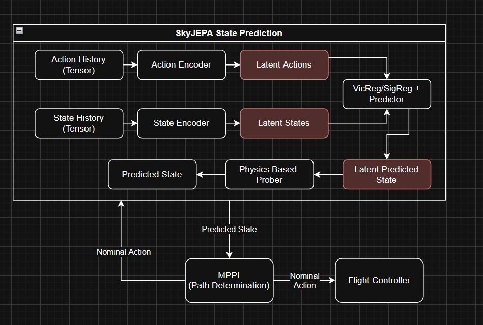

# SkyJEPA

This README provides a comprehensive overview of the entire project and how everything wires together. 
Refer here for any questions about design decisions, information flow, etc. 

Below is a helpful visualization of the original SkyJEPA paper (thanks Ethan!)

### Visualization of SkyJEPA

## Breakdown of Folders

### /skyjepa (WIP)
Includes the model, the data pipelines that take CSV to input data, and the training steps. 

### /drone (WIP)
Includes the ProjectAirSim client, flight control, and data logging (simulation to CSV).

### /docs
General documentation. Contains tensor_shapes.md which I'm pretty sure is out of date.

### /images 
Contains image files, including visualizations of the project and model structure, as well as future output images from intermediate and final steps in the project. 

## Breakdown of Files by Section
### /skyjepa
    #### /data
    placeholder
    #### /env
    placeholder
    #### /models
    placeholder

    #### __init__.py

    #### baseline.py

    #### config.py

    #### losses.py

    #### train_jepa.py

    #### windows.py

### /drone
NOTE: you can check out Ethan's README inside of the drone directory, please check that out for a more detailed description on use. This part also requires a download of additional server software and packages through uv, so please refer to that walkthrough for the most up to date instructions. 

    #### /action_sequences
    Inside of /rnd_sky_training, we can find a set of randomly generated flight paths based on the set ranges of parameters outlined in the paper, stored as CSV. These are used in the training of the JEPA model. 
    There are also some flight logs of manual control, and takeoff, for debugging to make sure that the simulator is correctly functioning. 

    #### /flight_logs
    placeholder
    #### /simulations
    placeholder
    #### /subsystems
    placeholder

    #### custom_flight.py
    

    #### gamepad_flight.py

    #### projectairsim_client.log

    #### random_sequence_flight.py 