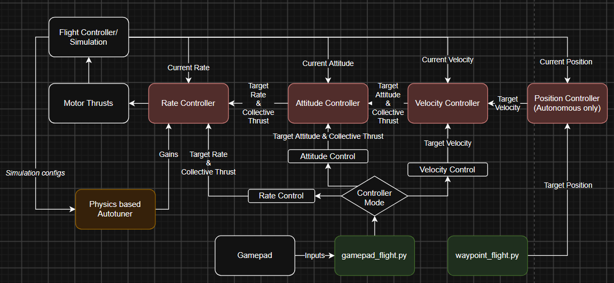
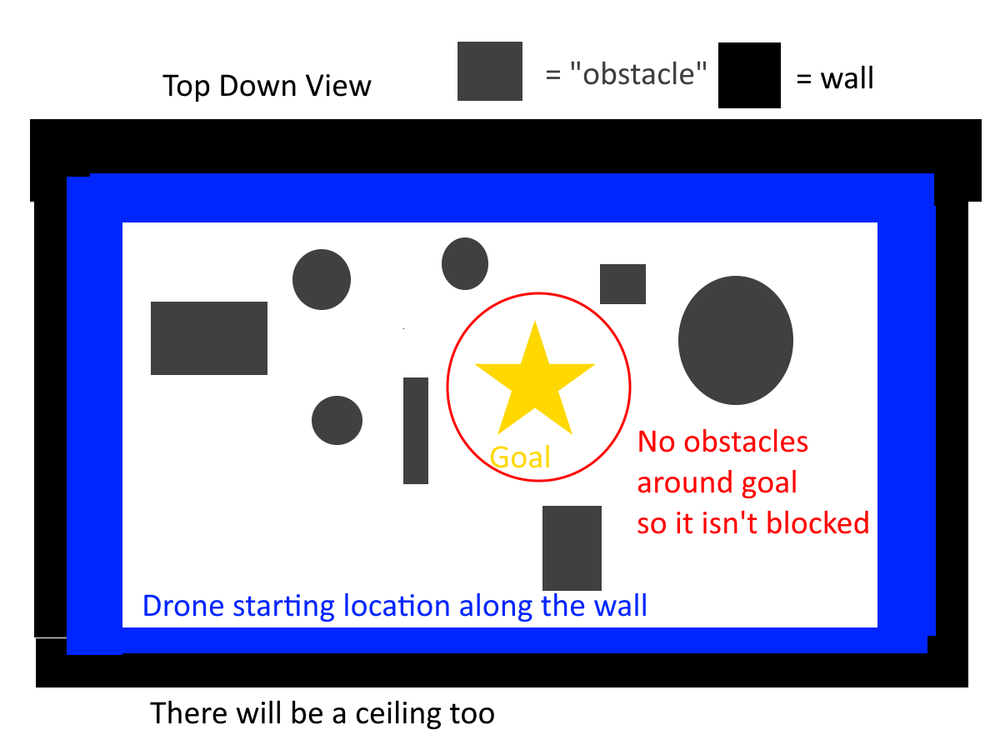
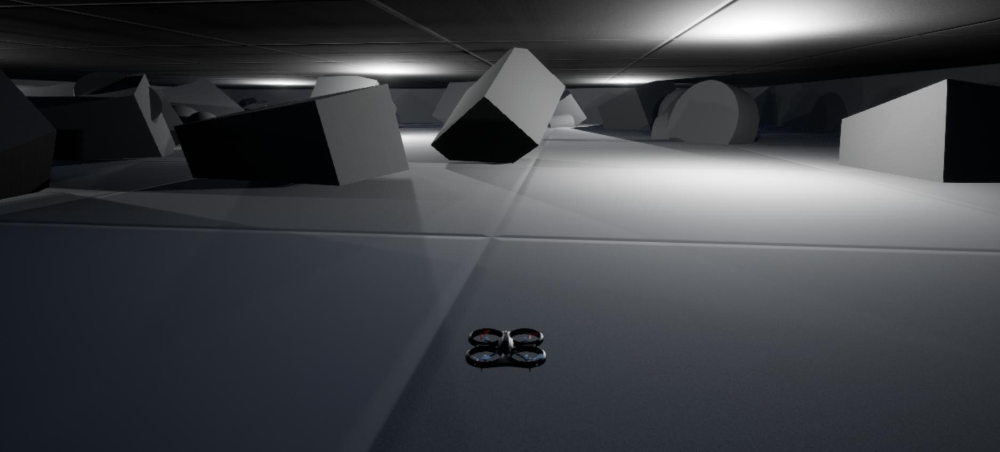
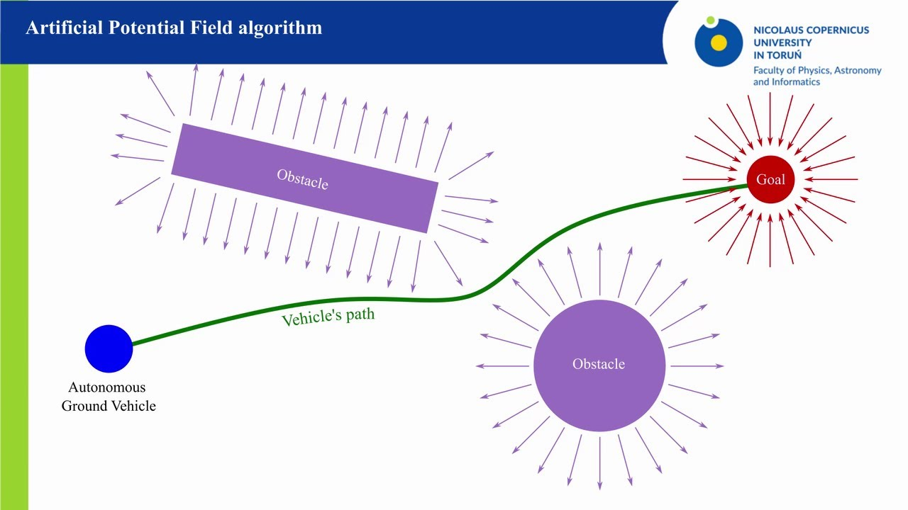
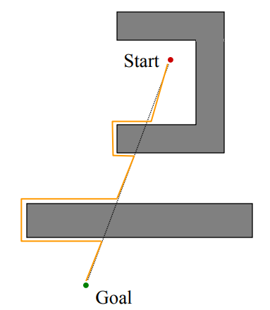
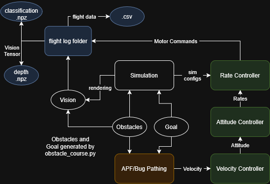

# SUMMARY (11/6/26)
This read me contains info on how to setup the simulation, how the simulation works, the format data is logged in, and how data is acquired.

# FYI (10/7/26)
The contents of the drone folder may be moved up outside of the drone folder and then the drone folder deleted if that makes training JEPA easier, I have all my (Ethan) simulation and control stuff in this "drone" folder because I did not want to be intrusive on the project.

# SIMULATION SETUP (10/7/26)
To run the simulator you need to run the server and the client.
The server is not on this file, you have to download it (see step 1).
Once you have the server running, you need to run a client. There are some sample python clients in this folder:

custom_flights.py lets you chose a csv file in data_sequences to run. This is good for replaying flights
gamepad_flights.py lets you manually use a controller to fly a drone.

waypoint_flight.py spawns a drone in and has the drone autonomously move to various points. Good for autonomous data acquisition.

All flights can be logged, and if chosen to, will show up in flight_logs. If you want to replay them, copy or move it to data_sequences, and then run them through custom_flights.py.


# Step 1. Setup server: Download an Environment
-> I am going to use blocks:
https://github.com/iamaisim/ProjectAirSim/releases

-> On version 1.01 there is Blocks-Windows-1.0.1.zip 
-> Download that
-> Extract it somewhere
-> Open it and you should see an Unreal Engine app called Blocks
-> Open it. If windows pops up, clicck more info then run anyway
-> Setup Unreal Engine, and then keep it open.

IMPORTANT: If the simulator ever fails to run, try using task manager and completely killing it.

# Step 2. Setup client: Done through uv
This is done through uv, so if you followed the uv instructions you are good to go.
Here are the dependencies the simulator and client require:
```
uv add projectairsim==1.0.2
uv add pandas
uv add sciPy
uv add json5
uv add opencv-python
```
# Step 3. Run the client
-> Go to the drone
```
cd drone
uv run python custom_flight.py
```
TODO: I might make this be able to be ran outside of the drone folder

# Other info that is useful:
For simulation I have time be steppable, not real time, this way lag does not effect anything
I do this by having drone/simulations/sim_config/scene_basic_drone.jsonc have this:
```
"clock": {
    "type": "steppable",
    "step-ns": 1000000,
    "real-time-update-rate": 3000000,
    "pause-on-start": true
  },
```
step-ns is typically 3000000 but I have it as 1000000 because that divides nicely with 10 miliseconds (100Hz) compared to 3 miliseconds -> floating point error sucks man

Anyways because its steppable I run this in the simulation:
```
self.world.continue_for_n_steps(
    FlightController.CONTROL_STEPS_PER_MILLISECOND,
    wait_until_complete=True,
)
```

where CONTROL_STEPS_PER_MILLISECOND is 10 because 1 step is 1 milliseconds and 100 Hz is 10 milliseconds

Also I have the simulator act as a flight controller because they are essentially doing the same thing relative to the drone:
1. Send measured state to the drone.
2. Recieve actions and do said actions which causes a corresponding change of measured state.
3. Allows for easy logging of both flight controller data and simulator data.

# Drone/Simulation Configs
Currently the following variables are optionally randomized:

```
mass
thrust_coef
torque_coef
arm_length
motor_time_constant
drag_coef
```
See simulation_config.py for the variation and default values

# Data logs
The csvs have info as follows:
- Header: Drone/Simulation Configs 
- Rows: time,FL,FR,BL,BR,x,y,z,vx,vy,vz,r1x,r1y,r1z,r2x,r2y,r2z,r3x,r3y,r3z,wx,wy,wz

*Example header: # CONFIG: {"mass": 1.22, "thrust_coef": 0.109919, "torque_coef": 0.040164, "arm_length": 0.3578, "motor_time_constant": 0.005, "drag_coef": 0.325}*

*time is seconds passed since the start of simulation.* 

*FL,FR,BL,BR are motor actions (0 - 4.18 where 4.18 is assumed max thrust).*

*x,y,z are position, vx,vy,vz are velocity, r1x,r1y,r1z...r3z is the rotation matrix. wx,wy,wz are the angular velocities.*


# Flight Modes (11/6/26)

The drone has the following flight modes:
1. Motor Thrusts (fl,fr,bl,br)
2. Rate (Angular Velocities) + Collective thrust. 
- Inputs: Target pitch/roll/yaw rates, current pitch/roll/yaw rates, collective thrust
- Outputs: Target Motor thrusts
3. Attitude (Angles) + Collective Thrust. 
- Inputs: Target Rotation matrix, Current Rotation matrix, Collective thrust
- Outputs: Target Rates
4. Velocity 
- Inputs: Target Velocity, Current Velocity
- Outputs: Target Attitude + Collective Thrust
5. Position Autonomous only
- Inputs: Target Position, Current Position
- Outputs: Velocity

-> See Controllers.py for the control logic
-> See Gamepad.py for the manual controls for each

Everything is in ascending order of abstraction where:
Position control needs velocity control which needs attitude control which needs rate control which needs motor control

All the controllers utilize a series of PID controllers + some physics to generate output



# Autotuner (11/6/26)
Codex generated a physics model that automatically creates the gains (P in PID) for the rate controller. The layers above the rate controller do not need to change assuming the rate controller works.

See a video on it here:
https://www.youtube.com/watch?v=E7-F3rcVzWI


# Autonomous Flight & Data Collection (11/6/26)
Since the drone can be running random configurations and, using the autotuner, can fly to a target point, this is useful for data collection.

On my Computer (Ethan) collecting data with the simulation rendering is about 2x real life time. So for 20k 10 second flights, that would take approximately 55 hours. To make it faster I am making some sacrifices:

1. Since reloading the simulation takes about 5 seconds, I am making the flights 100 seconds long and doing 2k flights, that way it has to reload less. This then gets split up into 10 second flights.
2. I am disabling rendering for increased simulation speed.

# Randomized Obstacle Course (11/17)
For the drone to learn about vision, it needs to actually see and interact with objects.
To prevent the drone from simply flying above all obstacles, the drone will be in an obstacle course with a ceiling and walls.
The goal position is known and has a 50 meter clearance around it with no obstacles, that way it is always possible to reach.
- 3 Obstacle Shapes: Sphere, rectangle, and disk
- The obstacles can be various sizes and quantity (as of writing 10 rectangles, 5 spheres, and 5 disks)
These shapes were chosen because they already exist in the map and are geometrically easy to use.





To avoid conglomerations of shapes, sparsity is forced.

The obstacle course is logged in the csv for replayability


# Vision Data formatting and Collection (11/17)
To base the simulator cam off of the Oak d lite the camera has a resolution of 640x480 with a max framerate of 117 fps. In simulation I make it match 100 fps along with state and action update frequency. 10 meters of reliable depth. 20 meters depth max. 0.5 meters of depth min.

2 data streams exist from the simulator:
1. grayscale
2. depth

These will eventually be fed into an image encoder to turn into the following tensor:

## Vision Tensor
The vision tensor is a 32x32x2 tensor.
Each "cell" in the 32x32 grid represents 20x15 pixels. Inside each cell are 2 values:
1. Depth (uint8) -> Stored as integer but represents a float. Checkout SimCam.py for process of conversion. uint8 takes less space.
2. Classification (uint8) -> Represents the type of object the cell is looking at (ex. "door", "obstacle", "wall") etc. This is represented as an integer to save space. The integer key to values can be seen in both SimCam.py and encoders.py (CLASSES)

Checkout this video to see some gamepad flight footage in the obstacle course including the drones tensor vision:
https://www.youtube.com/watch?v=nQfX8dcBXx0
*NOTE: The green arrow in the video is added after the tensor is generated. The drone will not "see" the goal until it is actually within 10 meters.

The data is logged NOT IN A CSV but seperatly as a depth.npz and classification.npz
The flight log will be a folder containing the flight log (csv) and the previous 2 .npz mentioned.

# Autonomous Obstacle Avoidance for data collection (11/17)

The drone will try to fly at about 2 m/s since that is cautious enough to brake and actually react when an obstacle approaches.

Used Artificial Potential Field (APF) algorithm for obstacle avoidance.
- Pros: Obstacle locations are known, computationally cheap
- Cons: Local minima.




To overcome local minima implemented a modified bug2 algorithm whenever the drone's speed drops too low near obstacles.




Each flight will be up to 100 seconds with it ending if the goal is reached or 100 seconds pass.

Watch the video here to see it in action:
https://www.youtube.com/watch?v=XcqVbPQu19E

Here is the architecture:

